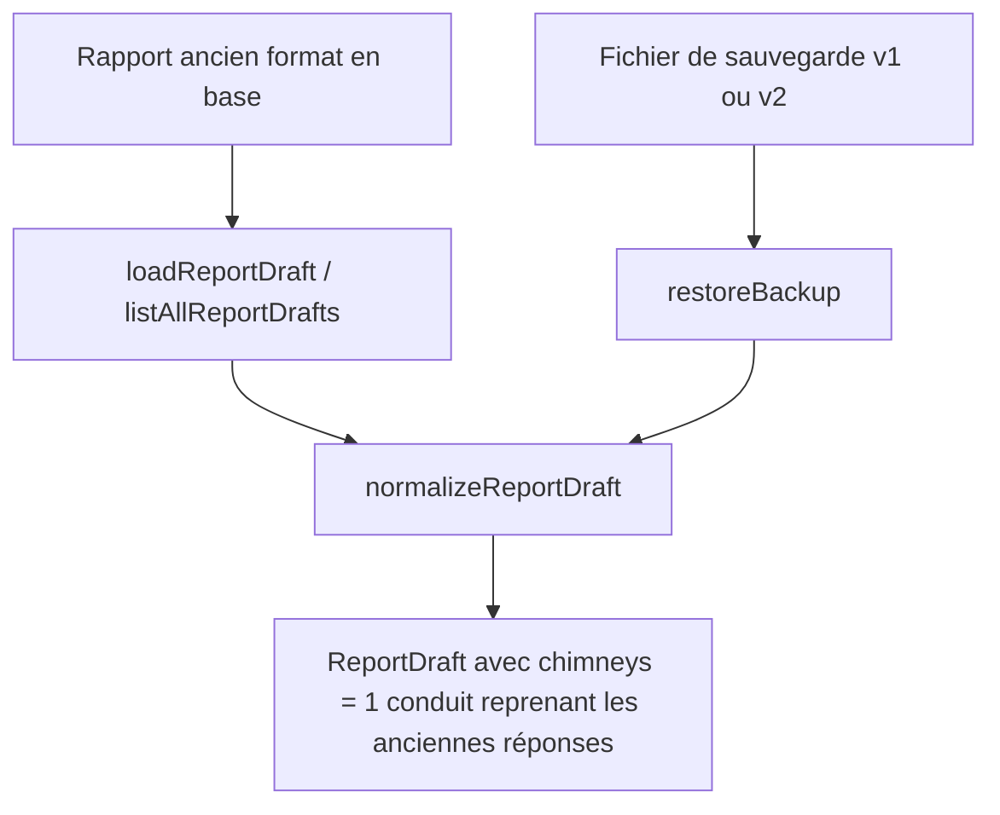
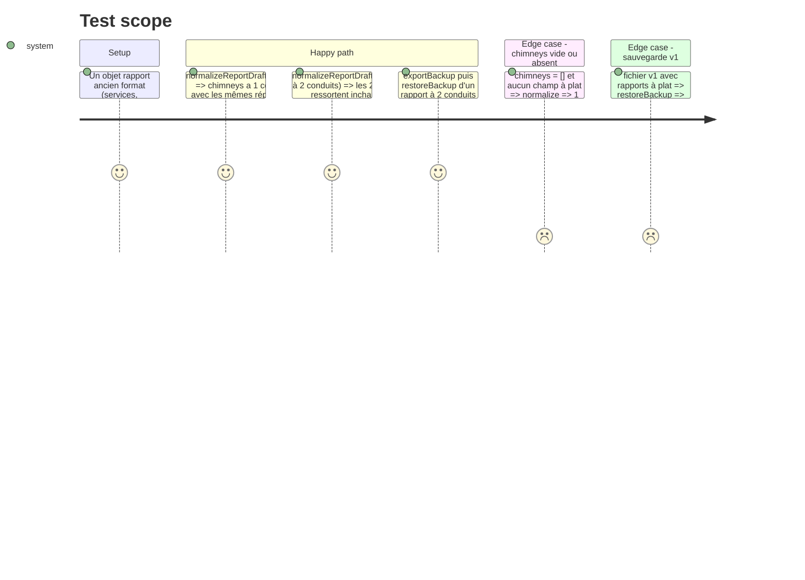

# Instruction: Modèle de données, migration, sauvegarde

## Architecture projection

```txt
src/lib/
├── report.ts            ✏️ type ChimneyEntry, ReportDraft.chimneys, MAX_CHIMNEYS, chimneyLabel(), createEmptyChimney re-export
├── report-defaults.ts   ✏️ createEmptyChimney ; normalizeReportDraft convertit les champs à plat en chimneys[0]
└── backup.ts            ✏️ VERSION = 2, restaure les fichiers v1 et v2
```

## User Journey



## Test Scope



## Tasks to do

### `1)` Type et constantes

> Un rapport porte une liste de conduits.

1. Dans `report.ts`, ajouter `ChimneyEntry = { id, label, services, sootTypes, sootVolume, visibleDefects, advice, observations }`.
2. Remplacer ces six champs de `ReportDraft` par `chimneys: ChimneyEntry[]`.
3. Ajouter `MAX_CHIMNEYS = 6` et `chimneyLabel(chimney, index)` → `label` ou « Conduit n ».

### `2)` Conversion des anciens rapports

> Un rapport enregistré avant cette version s'ouvre avec un conduit.

1. `createEmptyChimney()` dans `report-defaults.ts` ; `createEmptyReport` démarre avec un conduit.
2. `normalizeReportDraft` : si `chimneys` est absent ou vide, construire `chimneys[0]` à partir des champs à plat, puis retirer ces champs de l'objet.
3. Normaliser aussi chaque conduit (champs manquants remplis).

### `3)` Sauvegarde

> Les sauvegardes transportent les conduits et les anciennes restent restaurables.

1. `VERSION = 2` dans `backup.ts` ; la restauration accepte toute version ≤ 2 (déjà le cas via le contrôle `> VERSION`).
2. La restauration passe déjà par `normalizeReportDraft` : vérifier qu'un fichier v1 donne bien 1 conduit.

## Test acceptance criteria

| Task | Acceptance criteria |
| ---- | ------------------- |
| 1 | `tsc` passe ; plus aucune référence à `report.services`, `report.sootTypes`, etc. en dehors de la conversion. |
| 2 | Un ancien rapport sur l'émulateur (APK 1.1.0 → nouvelle version) s'ouvre avec ses réponses intactes dans « Conduit 1 ». |
| 3 | Une sauvegarde exportée par la 1.1.0 se restaure ; une sauvegarde v2 se restaure avec tous ses conduits. |
