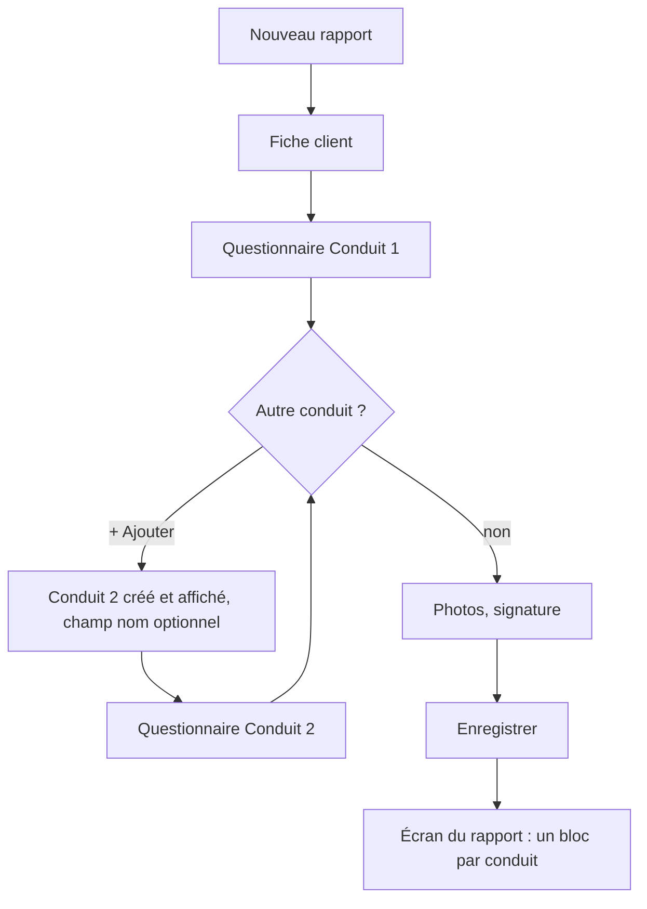
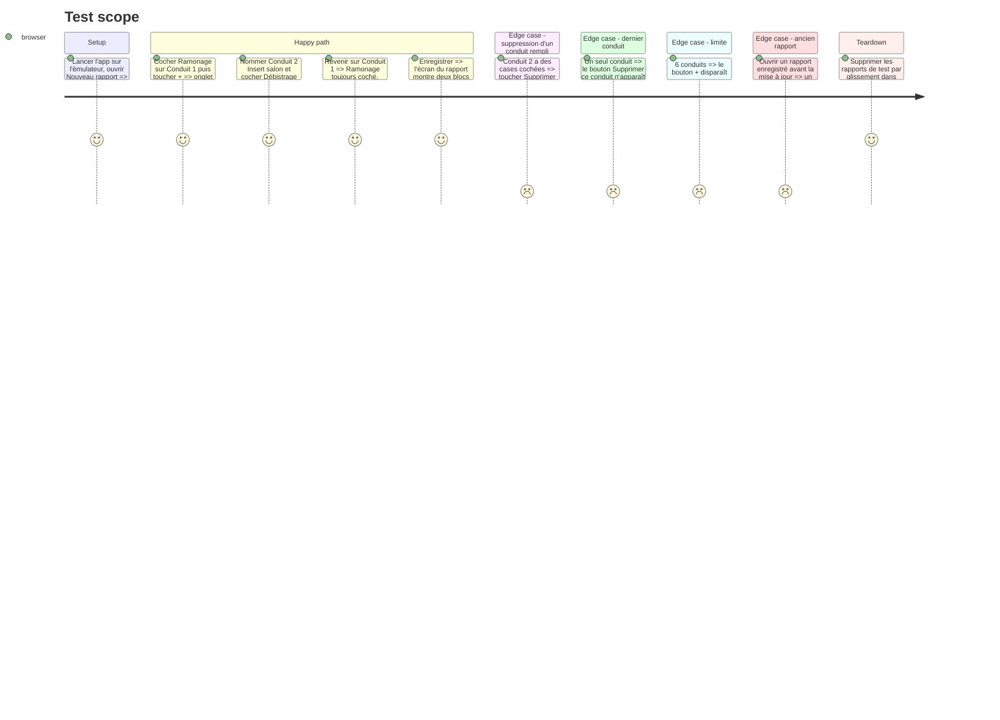

# Instruction: Formulaire et écran du rapport

## Architecture projection

```txt
src/
├── app/report/
│   ├── new.tsx          ✏️ onglets de conduits, questionnaire du conduit actif, ajout / suppression / nom
│   └── [id].tsx         ✏️ sections 01–04 répétées par conduit, sous un titre de conduit
└── components/ui/
    └── chimney-tabs.tsx ✅ rangée d'onglets « Conduit 1 · Conduit 2 · + », pastille complet / incomplet
```

## User Journey



## Test Scope



## Wireframe

```txt
Formulaire (new.tsx)
┌─────────────────────────────────────┐
│ (1) Barre de progression            │
├─────────────────────────────────────┤
│ (2) Fiche client                    │
│     Nom · Prénom · Date · Adresse…  │
├─────────────────────────────────────┤
│ (3) [Conduit 1 ●][Insert salon ○][+]│
│ (4) Nom du conduit (facultatif)     │
│ (5) 01 Prestation                   │
│     02 Rapport d'intervention       │
│     03 Conseils                     │
│     04 Autres observations          │
│ (6) Supprimer ce conduit            │
├─────────────────────────────────────┤
│ (7) 05 Photos · 06 Signature        │
├─────────────────────────────────────┤
│ (8) [Sans PDF] [Enregistrer + PDF]  │
└─────────────────────────────────────┘

Rapport enregistré ([id].tsx)
┌─────────────────────────────────────┐
│ (9) Tampon · client · date · contact│
├─────────────────────────────────────┤
│ (10) CONDUIT 1 / 2 · Salon          │
│      01 Prestation … 04 Observations│
│ (10) CONDUIT 2 / 2 · Insert         │
│      01 Prestation … 04 Observations│
├─────────────────────────────────────┤
│ (11) 05 Photos · 06 Signature       │
├─────────────────────────────────────┤
│ (12) [Abby] [PDF dans mes fichiers] │
└─────────────────────────────────────┘
```

1. Progression : chaque étape n'est faite que si elle l'est pour tous les conduits.
2. Fiche client : inchangée, unique au rapport.
3. Onglets de conduits : choisissent le questionnaire affiché ; pastille pleine quand le conduit a prestation et constat ; « + » ajoute un conduit.
4. Nom du conduit : libre (« Salon », « Insert », « Chaudière »), sinon « Conduit n ».
5. Questionnaire du conduit actif : les quatre sections actuelles.
6. Suppression : présente seulement s'il y a plus d'un conduit.
7. Photos et signature : uniques au rapport.
8. Barre d'action : inchangée.
9. En-tête du rapport : inchangé.
10. Un bloc par conduit, titre affiché seulement s'il y a plus d'un conduit.
11. Photos et signature : inchangées.
12. Barre d'action : inchangée.

## Tasks to do

### `1)` Onglets de conduits

> Passer d'un conduit à l'autre et en ajouter d'un geste.

1. Créer `chimney-tabs.tsx` : ScrollView horizontale de puces (`PressableScale`, cible ≥ 48 dp), puce active en couleur livrée, pastille complet/incomplet, puce « + » masquée à `MAX_CHIMNEYS`.
2. `tickHaptic` au changement d'onglet, transition CSS sur la couleur (`Motion.state`, `EaseOut`), comme `CheckRow`.

### `2)` Formulaire par conduit

> Le questionnaire écrit dans le conduit actif.

1. Dans `new.tsx`, état `activeChimneyId` ; `updateChimney(id, patch)` remplace `updateField`/`updateMultiChoice` pour les champs de conduit.
2. Champ « Nom du conduit » au-dessus de la section 01.
3. « + » : ajoute `createEmptyChimney()`, l'active et remonte le défilement en haut du questionnaire.
4. « Supprimer ce conduit » : confirmation si le conduit a des réponses (`Alert.alert` natif, `window.confirm` sur le web), puis active le conduit voisin.
5. `steps` de `FormProgress` : « done » seulement si vrai pour tous les conduits.
6. Pré-remplissage `from` : inchangé (le client seulement, pas les conduits).

### `3)` Écran du rapport

> Relire chaque conduit comme sur le PDF.

1. Dans `[id].tsx`, répéter les sections 01–04 par conduit, sous un titre « Conduit 1/2 · Salon » (`label` type), seulement quand il y a plus d'un conduit.
2. Photos et signature renumérotées après les conduits, comme aujourd'hui (05, 06).

## Test acceptance criteria

| Task | Acceptance criteria |
| ---- | ------------------- |
| 1 | Sur l'émulateur, les onglets défilent horizontalement, l'onglet actif est visible, « + » disparaît au 6ᵉ conduit. |
| 2 | Les réponses d'un conduit ne débordent jamais sur un autre ; supprimer un conduit rempli demande confirmation ; la barre de progression ne passe au complet que quand tous les conduits le sont. |
| 3 | Un rapport à 2 conduits montre deux blocs titrés ; un ancien rapport montre un seul bloc sans titre, comme avant. |
