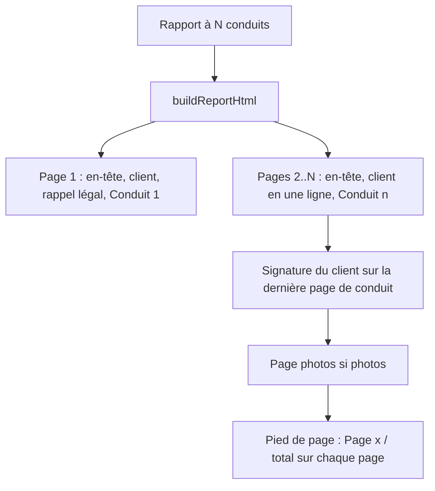
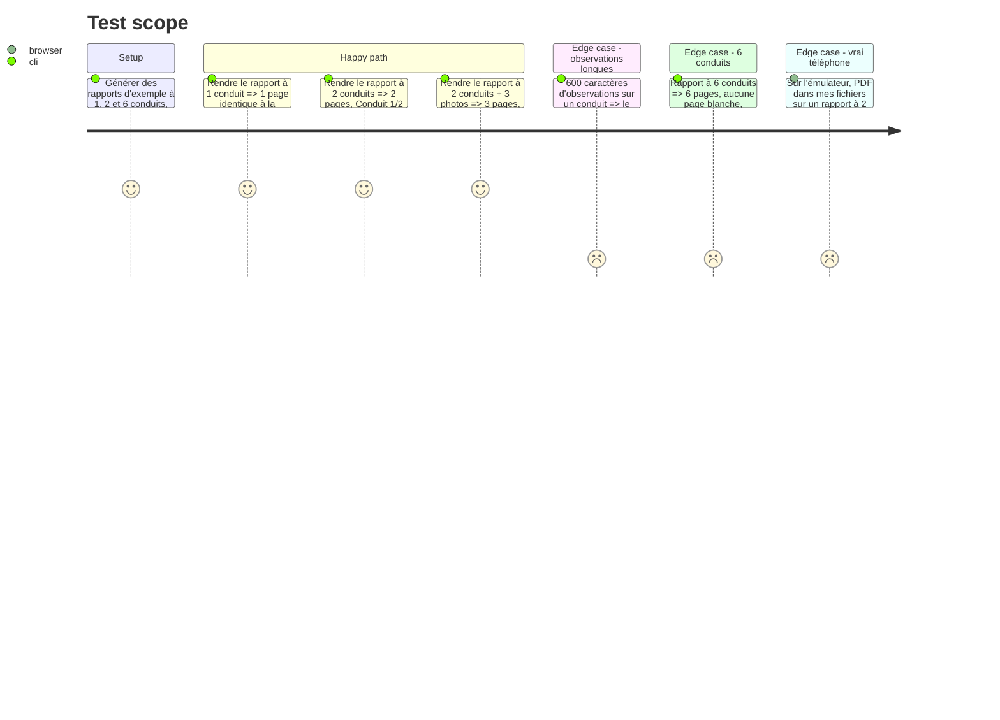

# Instruction: PDF multi-conduits et vérification

## Architecture projection

```txt
src/lib/
└── report.ts                      ✏️ buildReportHtml : une page A4 par conduit, rappel légal page 1, signature sur la dernière page de conduit, numéros de page
scripts/
└── render-report-pdf.mjs          ✅ rend des rapports d'exemple en PDF (Edge/Chrome headless) pour contrôle visuel
```

## User Journey



## Test Scope



## Tasks to do

### `1)` Gabarit par conduit

> Chaque conduit occupe sa page, sans jamais être coupé.

1. Découper `buildReportHtml` : `chimneyBlock(chimney, index, total)` regroupe prestation, rapport, conseils + bonnes pratiques bois, observations.
2. Page 1 : en-tête, bandeau titre, identité complète, rappel légal, conduit 1.
3. Pages suivantes : en-tête, bandeau titre « Conduit n / N · nom », identité en une ligne (client · date · adresse), conduit n.
4. Chaque `.page` : `page-break-after` sauf la dernière, `break-inside: avoid` sur les blocs, hauteur bornée à une feuille A4.
5. Signature du client sur la dernière page de conduit seulement ; la page 1 garde l'espace actuel quand il n'y a qu'un conduit.
6. Pied de page « Page x / total » sur chaque page, photos comprises.
7. Un rapport à un conduit : même bandeau, même mise en page qu'aujourd'hui (pas de « Conduit 1/1 »).

### `2)` Observations longues

> Un texte long ne fait pas déborder la page.

1. Plafonner le champ observations à 600 caractères dans le formulaire (`maxLength`), avec le compteur du `TextField`.
2. Vérifier au rendu que 600 caractères tiennent sur une page de conduit ; sinon réduire l'interligne du paragraphe sur ces pages.

### `3)` Contrôle visuel

> Voir les PDF avant de livrer.

1. `scripts/render-report-pdf.mjs` : construit les rapports d'exemple, appelle `buildReportHtml` (bundle esbuild avec stubs expo, comme lors des vérifications précédentes), écrit le HTML et l'imprime en PDF avec Edge headless (`--print-to-pdf`, A4, sans marges).
2. Ouvrir chaque PDF et comparer page par page aux critères ci-dessous.
3. Sur l'émulateur, générer le vrai PDF (APK de dev ou build preview) et le comparer au rendu local.

## Test acceptance criteria

| Task | Acceptance criteria |
| ---- | ------------------- |
| 1 | Rapport à N conduits = N pages (+1 si photos) ; chaque page a l'en-tête, le bandeau et son pied de page ; aucun conduit coupé entre deux pages ; la signature n'apparaît qu'une fois, sur la dernière page de conduit. |
| 1 | Un rapport à un conduit sort sur une page, visuellement identique à la version 1.1.0. |
| 2 | Un conduit avec 600 caractères d'observations tient sur sa page. |
| 3 | Les PDF générés sur l'émulateur ont le même nombre de pages et la même mise en page que les rendus locaux. |
